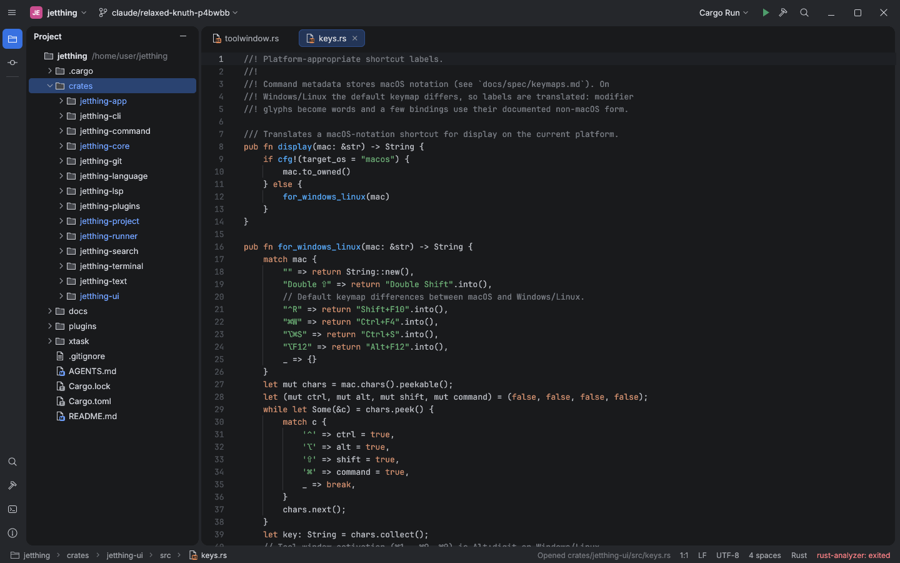

# Jetthing

Jetthing is an experimental, clean-room, native Rust IDE platform with a workbench
modelled on the observable layout of the IntelliJ New UI ("Islands Dark"): merged main
toolbar with project, VCS and run widgets, a tool window stripe, rounded editor and tool
window islands, Search Everywhere, and a status bar with navigation breadcrumbs.



## Run

```bash
cargo run -p jetthing-app                           # welcome screen, Open Project
cargo run -p jetthing-app -- .                      # open a project
cargo run -p jetthing-app -- . src/main.rs          # open a project and files
cargo run -p jetthing-cli -- commands               # headless command discovery
cargo run -p xtask -- parity                        # regenerate the parity dashboard
```

If wgpu finds no usable adapter (VMs, old drivers) the app falls back to OpenGL
automatically; `JETTHING_RENDERER=glow` forces it.

On Linux the window needs the X11/Wayland client libraries, for example on Debian/Ubuntu
`libxkbcommon-x11-0` (X11) or `libwayland-client0` (Wayland), plus OpenGL/Vulkan drivers.
A missing library is reported with the package to install.

Use **New Project** on the welcome screen or in File to generate an Empty, Rust,
or Java/Gradle project. Choose an existing parent folder and a new project name.
Java templates require JDK 21 and Gradle on PATH; Rust templates require Cargo.

## UI automation

Set `JETTHING_CONTROL_SOCKET=/path/ctl.sock` to let scripts drive a running IDE over
JSON lines: run commands, read state, send keys and text, wait, and take screenshots.

```bash
JETTHING_CONTROL_SOCKET=/tmp/jt.sock cargo run -p jetthing-app -- . &
export JETTHING_CONTROL_SOCKET=/tmp/jt.sock
cargo run -p jetthing-cli -- ui wait idle
cargo run -p jetthing-cli -- ui key Ctrl+Shift+A
cargo run -p jetthing-cli -- ui screenshot /tmp/find-action.png
cargo run -p jetthing-cli -- ui state
```

See `docs/parity/evidence/ui-control-socket.md` for the protocol.

## Builds, releases and updates

```bash
cargo run -p xtask -- dist     # release build staged in dist/jetthing-<version>-<os>-<arch>/
```

Every push to `main` runs `.github/workflows/release.yml`: it builds Linux, macOS and
Windows archives (with `.sha256` checksums). When the version in `Cargo.toml` has no
`v<version>` tag yet, the workflow publishes them as GitHub release `v<version>`. To ship
a new version, bump `[workspace.package] version` and merge.

The IDE checks for a newer release on startup and via **Help → Check for Updates…**.
A notification offers **Update and Restart**: the archive is downloaded, verified against
its checksum and swapped in place of the running executable (the previous one is kept as
`jetthing.old`). Development builds (`cargo run`) only link to the release page.

| Variable | Effect |
|---|---|
| `JETTHING_NO_UPDATE_CHECK` | disable the startup check |
| `JETTHING_GITHUB_TOKEN` / `GITHUB_TOKEN` | token for a private release repository |
| `JETTHING_UPDATE_REPOSITORY` | `owner/repo` to update from (default `HenrySchwerdt/jetthing`) |

## Keyboard

Shortcuts come from the reference IDE's bundled keymaps (`docs/spec/data/keymaps.json`).
The default follows the desktop (macOS, Windows, GNOME, KDE, XWin); pick another keymap or
change shortcuts in **Settings › Keymap**. Common defaults (macOS / Windows & Linux):

| Action | macOS | Windows / Linux |
|---|---|---|
| Search Everywhere | Double ⇧ | Double Shift |
| Find Action | ⇧⌘A | Ctrl+Shift+A |
| Settings | ⌘, | Ctrl+Alt+S |
| Project / Commit tool window | ⌘1 / ⌘0 | Alt+1 / Alt+0 |
| Find in Files | ⇧⌘F | Ctrl+Shift+F |
| Terminal | ⌥F12 | Alt+F12 |
| Run / Build | ⌃R / ⌘F9 | Shift+F10 / Ctrl+F9 |
| Close tab | ⌘W | Ctrl+F4 |
| Hide all tool windows | ⇧⌘F12 | Ctrl+Shift+F12 |
| Go to File / Recent Files | ⇧⌘O / ⌘E | Ctrl+Shift+N / Ctrl+E |
| Find / Replace in file | ⌘F / ⌘R | Ctrl+F / Ctrl+R |
| Go to Line | ⌘L | Ctrl+G |
| Duplicate / Delete line | ⌘D / ⌘⌫ | Ctrl+D / Ctrl+Y |
| Comment line | ⌘/ | Ctrl+/ |
| Move line up / down | ⌥⇧↑ / ⌥⇧↓ | Alt+Shift+↑ / Alt+Shift+↓ |
| Commit | ⌘K | Ctrl+K |
| Rename / Delete in Project tree | ⇧F6 / ⌦ | Shift+F6 / Delete |

## Assets and trademarks

UI colors are facts extracted from IntelliJ Community theme files (Apache-2.0, see
`docs/spec/data/NOTICE.md`). Fonts are Inter and JetBrains Mono under the SIL Open Font
License (`crates/jetthing-ui/assets/fonts/`). Icons are original vector drawings; no
JetBrains icons or artwork are bundled. IntelliJ and JetBrains are trademarks of
JetBrains s.r.o.; Jetthing is not affiliated with or endorsed by JetBrains.

See `docs/roadmap.md` for honest status and limitations.
