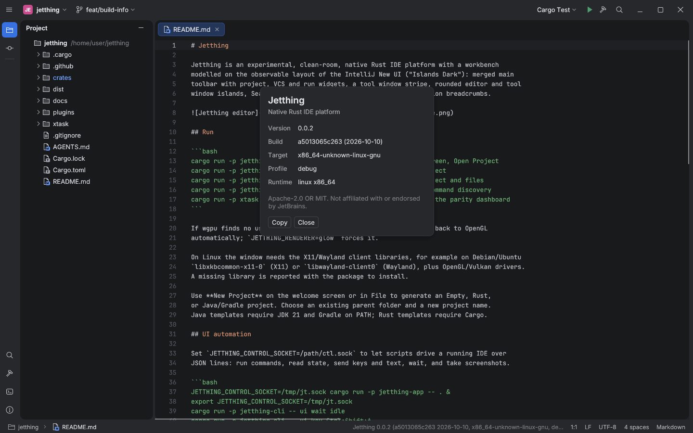

# About dialog and `--version`

Reference: IntelliJ-based IDEs show **Help → About** with the version, build number
and build date. `idea --version` prints the same on the command line, and a "Copy"
action puts the details on the clipboard for bug reports.

## Jetthing behaviour

- `jetthing --version` / `-V` and `jetthing-cli --version` print one line:
  `jetthing <version> (<commit> <commit date>, <target triple>, <profile>)`.
  `--help` / `-h` adds usage. Both exit before any window or GPU work starts. On
  Windows, release builds (GUI subsystem) attach to the parent console so the line
  shows up in the terminal.
- **Help → About Jetthing** (`app.about`; also reachable from Find Action and the
  control socket) opens a dialog. It shows the version, the build (commit and commit
  date), the target, the profile and the running OS/arch. **Copy** puts a plain-text
  report on the clipboard. **Close** or Escape dismiss it. The command returns the
  same data as JSON.
- `crates/jetthing-core/build.rs` embeds the metadata. The commit comes from
  `JETTHING_BUILD_COMMIT`, then `git rev-parse HEAD`, then `GITHUB_SHA`. The date
  comes from `SOURCE_DATE_EPOCH`, else the commit date, so rebuilding a commit is
  reproducible. Outside a git checkout both read `unknown`.

## Reproduction (Linux, Xvfb)

```text
$ cargo run -q -p jetthing-app -- --version
jetthing 0.0.2 (a5013065c263 2026-10-10, x86_64-unknown-linux-gnu, debug)
$ cargo run -q -p jetthing-cli -- -V
jetthing-cli 0.0.2 (a5013065c263 2026-10-10, x86_64-unknown-linux-gnu, debug)

$ Xvfb :99 -screen 0 1600x1000x24 &
$ export JETTHING_CONTROL_SOCKET=/tmp/jt.sock
$ DISPLAY=:99 JETTHING_RENDERER=glow JETTHING_NO_UPDATE_CHECK=1 jetthing-app . README.md &
$ jetthing-cli ui execute app.about
{"arch":"x86_64","commit":"a5013065c263","date":"2026-10-10","os":"linux","profile":"debug","target":"x86_64-unknown-linux-gnu","version":"0.0.2"}
$ jetthing-cli ui screenshot about-dialog.png
$ jetthing-cli ui state     # popups.about == true
$ jetthing-cli ui key Escape
$ jetthing-cli ui state     # popups.about == false
```



Tests: `build_info` unit tests (embedded metadata, version line, report, flag
handling), `about_opens_the_dialog_and_reports_the_build` (command), and the control
socket state test (`popups.about`).
