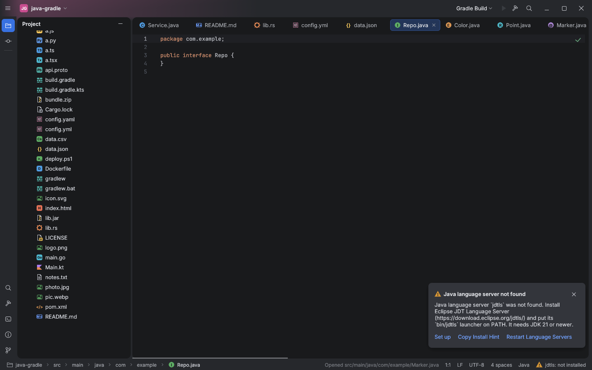
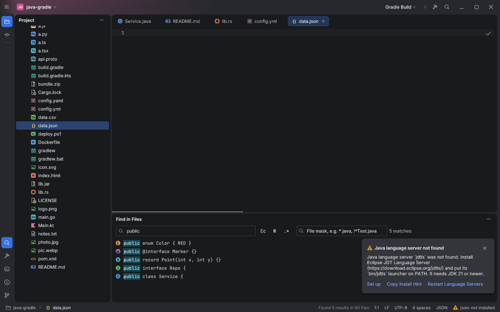

# File-type icons, second pass: the glyph carries the type

Before ([`file-type-icons-2/before.png`](file-type-icons-2/before.png)): every language
file was a generic page with a tiny corner badge. After: the glyph itself says what the file
is. All glyphs are original drawings on the 16px grid.

| Files | Glyph |
|---|---|
| Java | filled circle with `C` class, `I` interface, `E` enum, `R` record, `@` annotation; the kind is peeked from the first top-level declaration (comments, strings and nested types skipped; open documents in memory, others the first 8 KB from disk, cached by modification time); falls back to class |
| Kotlin / `.kts` | Kotlin triangle |
| Gradle (`*.gradle`, `*.gradle.kts`, `gradlew`) | green stacked bricks |
| JSON | `{}` |
| XML, `AndroidManifest.xml`, pom | `</>` |
| YAML, TOML, properties | settings sheet with sliders |
| Markdown | `M↓` frame |
| Shell, bat, cmd, ps1 | `>_` |
| Rust | gear |
| Python, JS, TS, TSX, Go, HTML, CSS, SQL, proto, CSV, Groovy, Dockerfile | full-size letter tile |
| png, jpg, svg, webp | picture frame |
| jar, zip | zipper page |
| `.gitignore`, `.editorconfig`, `LICENSE`, `README`, lock files | page with corner badge |

The same `IdeApp::file_icon` serves the Project tree, editor tabs, breadcrumbs, Find
results (new icon column), Recent Files and Search Everywhere.

Tests: `file_icons_follow_names_then_extensions` (table) and
`java_kind_is_peeked_from_the_first_top_level_type` (class/interface/enum/record/annotation,
comments, strings, nested types, `record` as an identifier).

## Gaps

The Kotlin mark is a simplified two-colour triangle without distinguishing class, object or
interface; Kotlin and Groovy types are not peeked. Folder breadcrumbs show no icons.
