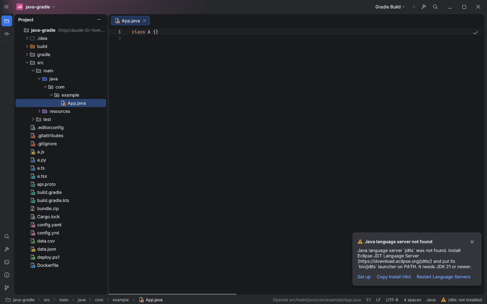
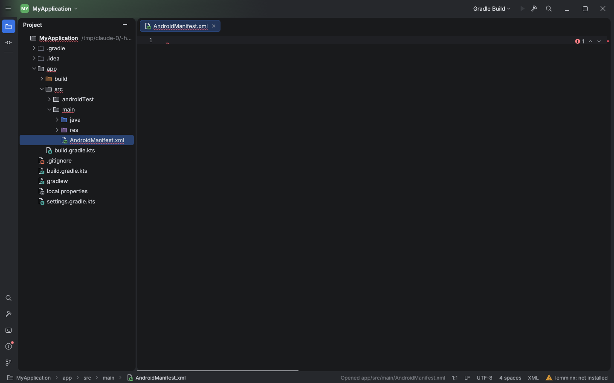

# File-type and folder icons

All icons are original vector drawings (no JetBrains artwork and no third-party icon set,
so no extra licence is needed): a 16px page with a coloured badge of one or two letters,
a picture glyph for images, a zipper glyph for archives, and tinted folders.

- `Icon::for_file(name)` is table-driven: exact names first (`AndroidManifest.xml`,
  `Dockerfile`, `.gitignore`, `.gitattributes`, `.editorconfig`, `LICENSE`, `README`,
  `gradlew`), then the longest matching extension (`build.gradle.kts` is Gradle, `x.kts`
  is Kotlin script). Unknown files, `.txt` and extension-less names use the generic page.
- `Icon::for_folder(path)` tints a folder by role: `src/<set>/java|kotlin` source (blue),
  test sets (green), `resources`/`res` (purple), `build`/`target`/`out` (orange),
  `.git`/`.idea`/`.gradle` (dimmed), directories inside a source root (package dot).
- The same function serves the Project tree, editor tabs, Find results, Recent Files,
  breadcrumbs and Problems.

Both trees are small sample projects created for the screenshots (a Gradle Java layout
and an Android app layout), shown under Xvfb. Unit tests cover every extension and
folder role listed above.

## Gaps

No per-module source/test/resource roots (classification is by path convention), no
overlay icons (VCS state, read-only), no icon theme switching.
