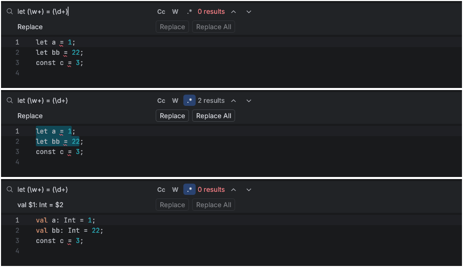

# Regex Find / Replace in the editor (IJ-NAV-063, IJ-NAV-068)

Reference: the editor Find/Replace bar (Ctrl+F / Ctrl+R) has Match Case, Words and Regex
toggles. In regex mode, `$1`-style group references in the replacement are expanded.

Jetthing (captured 2026-10-10 on Xvfb/glow; `Main.kt` holds `let a = 1;`, `let bb = 22;`
and `const c = 3;`):

1. Query `let (\w+) = (\d+)` with Regex off: literal text, 0 results.
2. **.\*** on: 2 results highlighted.
3. Replacement `val $1: Int = $2` and **Replace All**: `val a: Int = 1;`,
   `val bb: Int = 22;`. Status: "2 occurrences replaced". `const c = 3;` is untouched.

- `editor.findNext` / `findPrevious` / `replace` / `replaceAll` accept `regex`. Matching
  uses the `regex` crate in multi-line mode (`^`/`$` per line). Words wraps the pattern in
  `\b…\b`, case folding follows Match Case, and empty matches are skipped. Results are
  character offsets.
- Replacements expand `$1`, `${name}` and `$$` per match (`ops::regex_replacements`).
  Replace swaps the current selection only when it is exactly one match. Replace All is
  one undo step.
- An invalid pattern shows its error in the bar instead of the result count, and the
  commands reject it as invalid parameters.

Tests: `regex_find_and_capture_group_replacement` (text),
`regex_find_replace_and_replace_all_expand_groups` (core),
`regex_toggle_reaches_matches_params_and_errors` (UI).

Gaps: no Replace in Files, no Alt+C/O/X shortcuts, no regex help popup, no
"preserve case" option.
