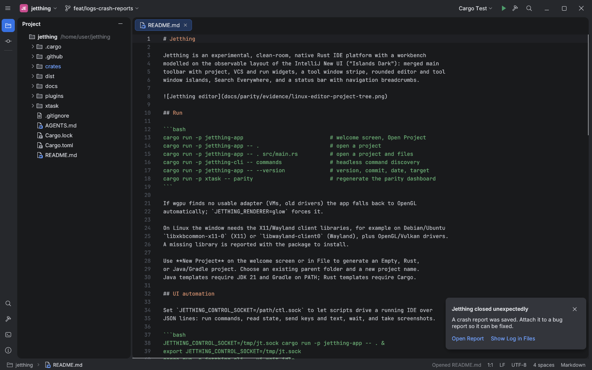

# Log file and crash reports

Reference: IntelliJ-based IDEs write `idea.log` to a per-OS log directory and offer
**Help → Show Log in Explorer/Finder/Files**. After an internal error or crash they show
a notification that links to the report.

## Jetthing behaviour

| OS | Log directory (`JETTHING_LOG_DIR` overrides) |
|---|---|
| Linux | `$XDG_STATE_HOME/jetthing/logs`, default `~/.local/state/jetthing/logs` |
| macOS | `~/Library/Logs/Jetthing` |
| Windows | `%LOCALAPPDATA%\Jetthing\logs` |

- **`jetthing.log`** records a session-start line (build, OS, pid), renderer fallbacks,
  failed commands and panics. Each record is one UTC-timestamped line. Above 5 MB the
  file rotates to `jetthing.1.log`.
- **Crash reports.** A panic writes `crash-<UTC time>-<pid>.txt` containing the build
  details (as in Help → About), the thread, the panic message and location, a full
  backtrace and the last 50 log lines. The path is also printed to stderr. Missing
  desktop libraries still produce the install hint instead of a report.
- **Next start.** A balloon reads "Jetthing closed unexpectedly", with links to
  **Open Report** (`app.openCrashReport`) and **Show Log in Files** (`app.showLog`).
  Dismissing it (`app.dismissCrashReport`) writes the newest report's name to
  `crash-reports.seen`, so the balloon does not come back for that report.
- **Help → Show Log in Files** (`app.showLog`) opens the directory in Explorer, Finder
  or the `xdg-open` handler.

## Reproduction (Linux, Xvfb)

Debug builds can trigger a test panic with `JETTHING_DEBUG_PANIC=1` (ignored in
release builds):

```text
$ export JETTHING_LOG_DIR=/tmp/jt-logs
$ JETTHING_DEBUG_PANIC=1 cargo run -q -p jetthing-app
jetthing: crash report written to /tmp/jt-logs/crash-20261010145126-16552.txt
thread 'main' (16552) panicked at crates/jetthing-app/src/main.rs:160:9:
JETTHING_DEBUG_PANIC requested a test crash
$ head -11 /tmp/jt-logs/crash-*.txt
Jetthing crash report
Time: 2026-10-10 14:51:26 UTC
Version: 0.0.2
Build: 4d34dd0594b3 (2026-10-10)
Target: x86_64-unknown-linux-gnu
Profile: debug
Runtime: linux x86_64
Thread: main
Panic: JETTHING_DEBUG_PANIC requested a test crash
Location: crates/jetthing-app/src/main.rs:160:9
$ cat /tmp/jt-logs/jetthing.log
2026-10-10 14:51:26 INFO  session start: jetthing 0.0.2 (4d34dd0594b3 2026-10-10, x86_64-unknown-linux-gnu, debug) on linux x86_64 (pid 16552)
2026-10-10 14:51:26 ERROR panic: JETTHING_DEBUG_PANIC requested a test crash; report /tmp/jt-logs/crash-20261010145126-16552.txt

# next start, driven over the control socket
$ DISPLAY=:99 JETTHING_RENDERER=glow JETTHING_CONTROL_SOCKET=/tmp/jt.sock jetthing-app . README.md &
$ jetthing-cli ui state                         # popups.crashReport == true
$ jetthing-cli ui screenshot crash-notice.png
$ jetthing-cli ui execute app.dismissCrashReport
$ jetthing-cli ui state                         # popups.crashReport == false
$ cat /tmp/jt-logs/crash-reports.seen
crash-20261010145126-16552.txt
```



Tests (`jetthing-core`):
- `diagnostics`: per-OS directories and override, UTC timestamps, single-line
  records, report contents, rotation, unseen ordering and dismissal, platform open
  handler.
- `diagnostic_commands`: notice shown until dismissed.
