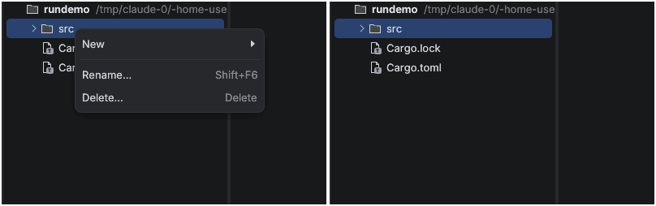
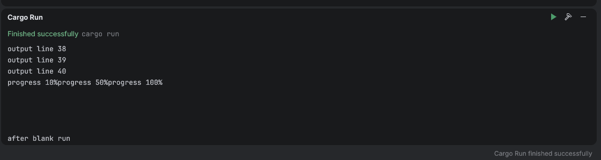
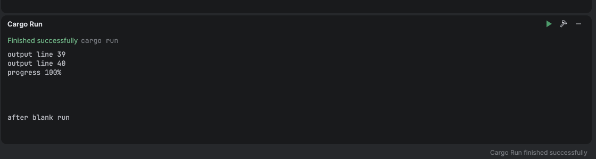

# Context menu Escape, Build/Run console, undo caret (#47 bugs 5, 12, 14)

Captured 2026-10-10 on Linux/Xvfb (glow) with `xdotool`.

## 5. Escape closes the project-tree context menu

The workbench's own Escape handling consumed the key before egui's popup saw it, so the
menu stayed open and other shortcuts (Alt+6) ran underneath it. Now any open menu (main
menu, context menu, toolbar widget popup) owns the keyboard, as in the reference IDE.
Escape closes it, and no workbench chord fires while it is open.

Test: `escape_closes_an_open_menu_and_shortcuts_do_not_run_under_it`.

## 12. Build/Run console

Sample program: 40 lines, then `progress 10%\rprogress 50%\rprogress 100%\n`, then four
blank lines and `after blank run`.

| Before | After |
|---|---|
|  |  |

- `\r` returns to the start of the line, so progress counters overwrite themselves (before:
  `progress 10%progress 50%progress 100%`).
- ANSI escape sequences are removed. Lines that end up empty only because escapes or `\r`
  erased their content (Gradle's rich-console progress) are dropped. Real blank lines in
  program output stay.
- Lines split across output chunks are joined. Before, every chunk boundary started a new
  row.
- Rows have a fixed height and the viewport holds whole rows only, so a view stuck to the
  bottom never cuts the first visible line under the status row.
- Converted lines are cached and only rebuilt when output grows.

Tests: `carriage_returns_overwrite_progress`, `lines_split_across_chunks_are_joined`,
`escape_sequences_are_stripped_and_erased_progress_dropped`,
`stderr_lines_keep_their_stream`, `viewport_holds_whole_rows`.

## 14. Undo moves the caret to the change

Undo and redo used to keep the caret wherever it was, only clamped to the new length. Now
`TextDocument::undo_carets` / `redo_carets` report one caret per edit of the transaction.
After undo the caret sits after the restored text (where typing started, or where the
caret was before a deletion). After redo it sits after the re-applied text. Multi-caret
edits restore every caret.

Tests: `undo_and_redo_report_carets_at_the_change` (text),
`undo_puts_the_caret_back_where_the_edit_happened` (core).

## Gaps

- The console has no clickable file links, filter, or ANSI colours yet (escapes are stripped).
- Undo does not restore a selection, only carets.
