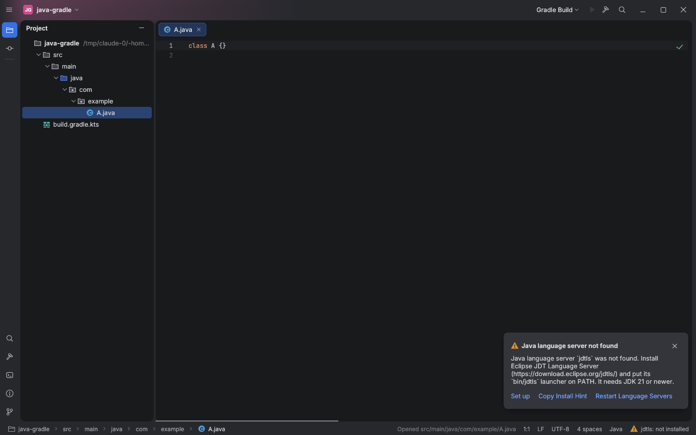

# Toolbar glow reaches the left tool stripe

The project-color glow is painted on the window background under the toolbar. The left
tool stripe (Project, Commit, …) sat directly below it with an opaque frame-colored fill, so
the glow stopped abruptly at the toolbar edge and the stripe stayed flat grey exactly where
the glow is strongest. The stripe now has no fill (the window clears to the frame color), so
the glow continues into it and fades with the same vertical falloff as in the island gaps.

## Gaps

The glow still fades out within half a toolbar height below the toolbar, as in the reference
profile; the stripe is tinted only along that top part. Other chrome with an opaque fill
(right stripe, status bar) is outside the glow area.
