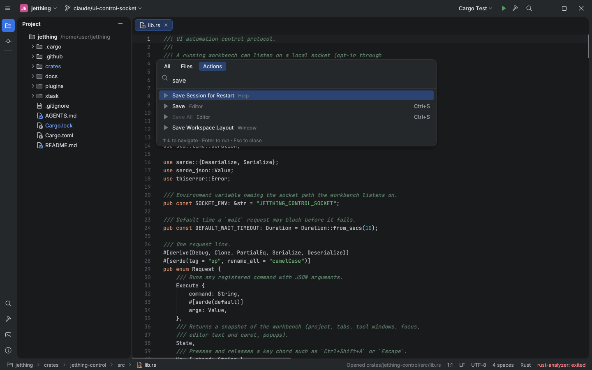

# UI automation control socket

Reference: IntelliJ-based IDEs are driven in UI tests by an in-process robot
(Remote Robot / Driver) that executes actions, sends keystrokes and captures the
window. Jetthing's equivalent is an opt-in local socket, so parity scenes and
smoke tests need no `xdotool` clicking.

## Protocol

Start the IDE with `JETTHING_CONTROL_SOCKET=/path/ctl.sock`. Each request is one
JSON line and gets one JSON response line (`{"ok":true,"result":…}` or
`{"ok":false,"error":"…"}`):

| Request | Effect |
|---|---|
| `{"op":"execute","command":"editor.openFile","args":{"path":"src/main.rs"}}` | runs any registered command |
| `{"op":"state"}` | project, tabs (modified flag), active tab, visible tool windows, focused component, active editor text/caret/selection count, popups (Search Everywhere tab, dialog kind, find bar, completion, notification), status text, background busy flag |
| `{"op":"key","chord":"Ctrl+Shift+A"}` | injects press/text/release events through egui input, i.e. the same shortcut and focus paths as a real keystroke; modifiers `Ctrl`, `Alt`, `Shift`, `Cmd`, and `Primary` (⌘ on macOS, Ctrl elsewhere) |
| `{"op":"type","text":"save"}` | text input into the focused component |
| `{"op":"screenshot","path":"out.png"}` | PNG of the window via egui's viewport screenshot (glow and wgpu; no X11 dependency) |
| `{"op":"wait","until":"idle\|popup\|text","text":"…","timeoutMs":10000}` | blocks until no search/task/update/screenshot is running and input has settled for 3 frames, a popup is visible, or the active editor/status bar contains `text` |

`jetthing-cli ui [--socket PATH] <execute|state|key|type|screenshot|wait|raw> …`
wraps the socket. A stale socket file from a crashed instance is replaced; a
live one is refused. The socket file is removed on exit.

## Reproduction (Linux, Xvfb)

```bash
Xvfb :99 -screen 0 1600x1000x24 &
export JETTHING_CONTROL_SOCKET=/tmp/jt.sock
DISPLAY=:99 JETTHING_RENDERER=glow JETTHING_NO_UPDATE_CHECK=1 \
  cargo run -p jetthing-app -- . crates/jetthing-control/src/lib.rs &
cli() { cargo run -q -p jetthing-cli -- ui "$@"; }
cli wait idle
cli key Ctrl+Shift+A && cli wait popup && cli type save && cli wait idle
cli screenshot docs/parity/evidence/control-socket-find-action.png
cli key Escape
cli execute toolwindow.toggle '{"id":"terminal"}' && cli wait idle
cli state   # toolWindows.bottom == "terminal", focus == "terminal"
```



Observed on 2026-10-10 (Xvfb, glow): Find Action opened by the injected chord,
the query typed, a 1440×900 PNG written; `key Ctrl+Bogus` and `execute nope`
returned structured errors.

## Gaps

- Unix domain sockets only; the Windows named-pipe transport is pending.
- Double Shift (modifier-only gesture) cannot be injected yet; use `Ctrl+Shift+A`
  / `Ctrl+Shift+N` or the palette commands.
- Scripted scenes (`xtask scenes`) and the headless CI job follow in the next slice.
